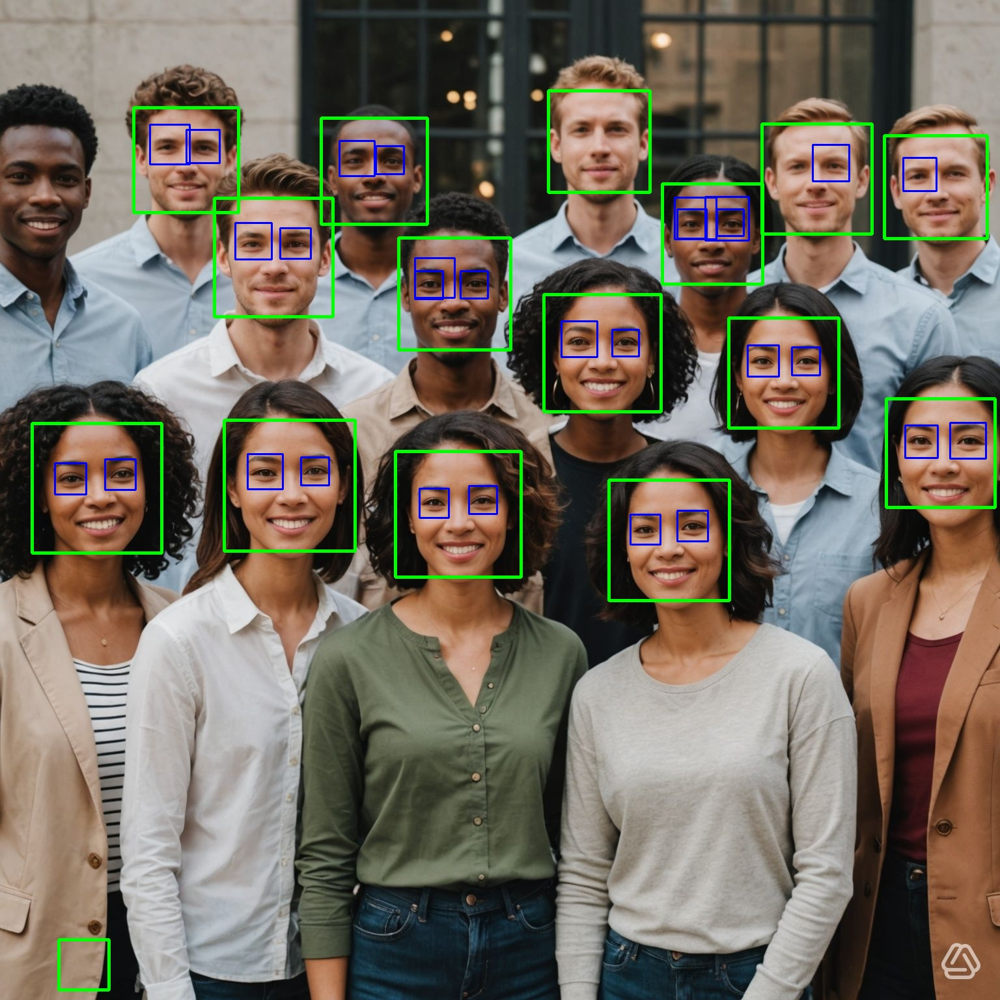
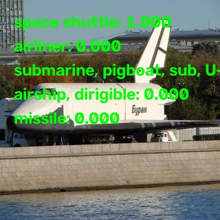

# C++ with node-addon-api 

Learning repository for building **native Node.js addons in C++** using [node-addon-api](https://github.com/nodejs/node-addon-api) (N-API) and [cmake-js](https://github.com/cmake-js/cmake-js), with a TypeScript call from node js.


There easy way to run an external tool. [Child Process](https://nodejs.org/docs/latest-v22.x/api/child_process.html) can launch a new process to run a command or an script it's cover 99% of use cases.

my goal here is using `Napi` and C++, of course can use any api from node js from `Napi` including child process,.

i did all these in my Mac M3

## Requirements

- **Node.js 22.x** (enforced via `engines` + `engine-strict`)
- **CMake** and a C++17 compiler (AppleClang/Xcode Command Line Tools on macOS)
- **Ninja** (optional, used automatically if available)
- **TypeScript**
It's necessary to enable `esModuleInterop` in your `tsconfig.json`:
```json
"esModuleInterop": true,
```
- **Visual Studio code** with the extension `C/C++` from microsoft.
- be sure to have the correct paths set in your `.vscode/c_cpp_properties.json` file.
- install cpp compilers. (clang, g++) 

All the projects have the same configuration.

## Warning

Each `CMakeList.txt` file has these two line, that are specific to my platform
be sure to use the right version of your Mac OSX sdk version

>> ls -la /Library/Developer/CommandLineTools/SDKs

```cmake
set(CMAKE_OSX_SYSROOT=/Library/Developer/CommandLineTools/SDKs/MacOSX26.5.sdk)
set(CMAKE_OSX_DEPLOYMENT_TARGET=15.4)
```

also change these line in `package.json` be sure to use the right version of your Mac OSX sdk version
```json
 "build": "SDKROOT=/Library/Developer/CommandLineTools/SDKs/MacOSX26.5.sdk npm run build:cmake",
```

be sure to modify `.vscode/c_cpp_properties.json` to include the correct paths for your project.

if you are using visual studio code.

```json
"includePath": [
                "${workspaceFolder}/**",
                "${workspaceFolder}/node_modules/node-addon-api/**",
                "_HOMEBREW_CELLAR_DIR_/opencv/5.0.0_10/include/opencv5"
            ],
```


## Projects

All the projects expose a C++ class to JavaScript via `Napi::ObjectWrap`.

All the projects have the same structure:
- src
    - bindings.ts -> import the module C++ class exposed, generate an interface.
    - index.ts -> Demo code.

### `demo_myObject`

A very basic demo native that exposes a C++ class (`MyObject`) with instance methods like `greet` and `add`.just make the essence to integrate C++/C code as module for node.

The functions are basic. add to numbers (`add`) and print the private variable _name (`greet`).


### `demo_buffer_async`

A More advanced example who use Promises and Buffer  expose(`BufferAsync`) with async methods.

#### AddAsync.
it use `Napi::Promise::Deferred` and `std::thread` to add two numbers asynchronously.
The thread as sleep for 1 second using `std::chrono`.

#### ReverseBuffer
it use cto reverse an input buffer asynchronously. 

### `demo_opencv`

More realistic example using OpenCV to process images. 
Integrating an external library with Napi.

#### Requirements only for macOS
- install brew (only mac) (https://brew.sh/)
- install opencv with brew, if want to install in local Applications folder
```bash
brew install opencv --appdir=~/Applications
```

OpenCv it´t world in itself, the goal is keep simple, and use the basics 

There 2  ways to integrate OpenCV with Napi. these is specifically for macOS, and if use brew to install opencv.
- using sources at include/opencv5 dir, since we using C++ and is necessary to include opencv *.h  files.
- using dylib libs at opencv/lib, are dynamic libraries, allow load the modules at runtime; allow load only the components needed 

>> use brew config, to check value of HOMEBREW_CELLAR an replace _HOMEBREW_CELLAR_DIR_ with the actual path,

Adding these lines into `CMakeLists.txt` will do the tricks

```cmake
# the version of opencv depends of formulae used and  the version.
set(HINT_OPENCV_DIR " _HOMEBREW_CELLAR_DIR_/opencv/5.0.0_10/lib")
if(NOT DEFINED OpenCV_DIR)
  set(OpenCV_DIR "${HINT_OPENCV_DIR}/cmake/opencv5" CACHE PATH "OpenCV cmake dir")
endif()

# find the components to be loaded
find_package(OpenCV REQUIRED COMPONENTS core imgcodecs imgproc)
message(STATUS "OpenCV found: ${OpenCV_VERSION}")
message(STATUS "OpenCV include dirs: ${OpenCV_INCLUDE_DIRS}")
message(STATUS "OpenCV libs: ${OpenCV_LIBS}")

# include sources of opencv
include_directories(${OpenCV_INCLUDE_DIRS})


add_library(${PROJECT_NAME} SHARED ${SOURCES} ${CMAKE_JS_SRC})
set_target_properties(${PROJECT_NAME} PROPERTIES PREFIX "" SUFFIX ".node")
# add opendv lib to target link libraries
target_link_libraries(${PROJECT_NAME} ${CMAKE_JS_LIB} ${OpenCV_LIBS})
```

if everything is right should see these lines when press `npm run build`

```bach
-- OpenCV found: 5.0.0
-- OpenCV include dirs: _HOMEBREW_CELLAR_DIR_/opencv/5.0.0_10/include/opencv5
-- OpenCV libs: opencv_core;opencv_imgcodecs;opencv_imgproc
```

### `opencv_facedetect_demo`

I want to continue learning, these time take a real example from the docs of opencv. [opencv sample face detect](https://docs.opencv.org/5.0/examples/opencv_contrib_modules_xobjdetect_samples_facedetect_cpp.html)

- imgproc: is for processing images.
- imgcodecs: is for reading and writing different image format.
- highgui: Manipulating windows context and mouse events [high gui opencv](https://docs.opencv.org/4.13.0/d7/dfc/group__highgui.html)
- videoio: is for video capture and writing.
- xobjdetect: is for object detection.

In these example we take an existing Cpp code and adapted to use napi.

##### warning!!! 
In the original code can access the camera and use highgui to open a window, i mean  highgui, it based on QT Library, a powerful toolkit for building GUI applications, agnostic to the underlying platform.

```cpp
  // videoio function
  VideoCapture capture;

  // highgui function
  void detectAndDraw( Mat& img, CascadeClassifier& cascade,
                    CascadeClassifier& nestedCascade,
                    double scale, bool tryflip )
```

The nature of node made impossible to access the camera and less using highgui, what I do is read an image as a buffer and apply face detection.


For face detection using haar cascade algorithm created by Rainer Lienhart  [Face detection xml file](opencv_facedetect_demo/assets/haarcascade_frontalface_alt.xml)

Eye detection use haar cascade algorithm created by [Shameem Hameedt](http://umich.edu/~shameem)  [Eye detection xml file](opencv_facedetect_demo/assets/haarcascade_eye_tree_eyeglasses.xml)


```cmake
find_package(OpenCV REQUIRED COMPONENTS core imgproc imgcodecs highgui videoio xobjdetect)
```

results:



### `opencv_classification_demo`

This demo showcases image classification using a pre-trained model (GoogLeNet) with OpenCV and Node.js.

To download the model file.

```python
cd opencv_classification_demo/assets/dnn
python3 -m venv path/to/venv
source path/to/venv/bin/activate
pip install -r requirements.txt
python download_models.py googlenet
deactivate
```

For more models see [models.yml](opencv_classification_demo/assets/dnn/models.yml) included in the assets folder.

The labels file (in english) [ILSVRC2012.txt](opencv_classification_demo/assets/classification_classes_ILSVRC2012.txt) is also included.
Can download as well from [from the official opencv dnn files](https://github.com/opencv/opencv/blob/5.x/samples/data/dnn/classification_classes_ILSVRC2012.txt).

The classification algorithm required both the model and the labels file as input

```js
    const classifier = new Classifier(googlenetModelPath, classificationClassesPath, {
        width: 224, 
        height: 224,
        topK: 5, // give the top 5 predictions
        swapRB: false, // swap red and blue channels
        crop: false, // crop the image
    });
```

Input image used by classification 


the results of the algorithm will be displayed in the console.
```bash
  Top predictions:
  [812] space shuttle: 0.9998
  [404] airliner: 0.0001
  [833] submarine, pigboat, sub, U-boat: 0.0001
  [405] airship, dirigible: 0.0001
  [657] missile: 0.0000
```

Image results image will be saved to `output/annotated.jpg`.


## Usage

it will fails if you don't use node 22.x

```bash
cd specific_projects_folder
npm install        
npm run build     
npm start        
```

The compiled addon is emitted at `build/Release/*.node` and loaded from the TypeScript code through `src/bindings.ts`.

## Topics covered

- N-API / node-addon-api class wrapping (`Napi::ObjectWrap`)
- Argument validation and throwing JavaScript exceptions from C++
- CMake configuration for Node addons (cmake-js, `NAPI_VERSION`, macOS `@rpath`)
- TypeScript interop with native modules
- Integration of OpenCV with Node.js.
