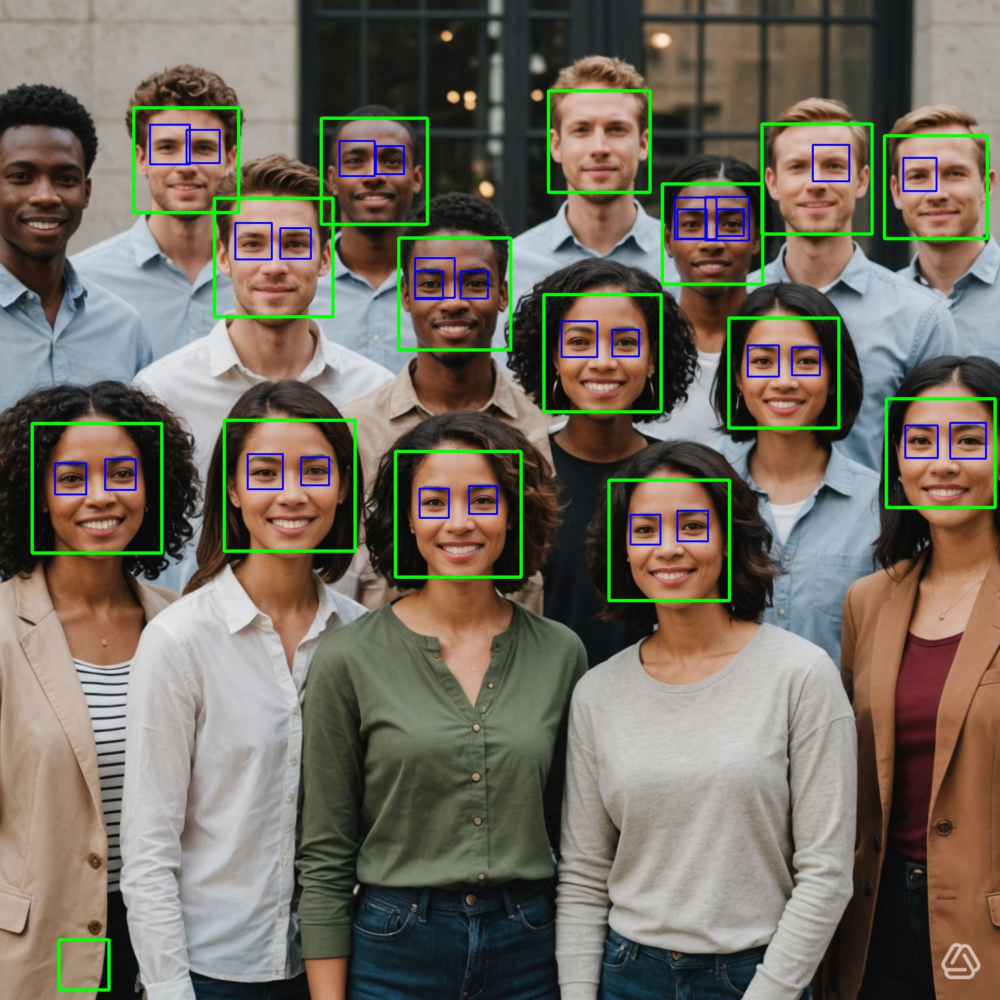
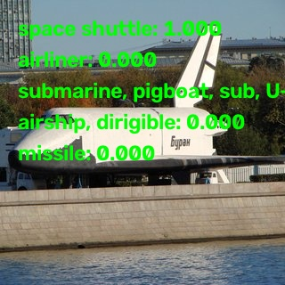

# C++ con node-addon-api
[Versión en inglés](README.md)

Repositorio de aprendizaje para crear **complementos nativos de Node.js en C++** usando [node-addon-api](https://github.com/nodejs/node-addon-api) (N-API) y [cmake-js](https://github.com/cmake-js/cmake-js), con una llamada desde TypeScript en Node.js.

Hay una forma sencilla de ejecutar una herramienta externa: [Child Process](https://nodejs.org/docs/latest-v22.x/api/child_process.html) puede iniciar un proceso nuevo para ejecutar un comando o un script, y cubre el 99 % de los casos de uso.

Mi objetivo aquí es usar `Napi` y C++. Por supuesto, se puede usar cualquier API de Node.js desde `Napi`, incluido Child Process.

## Requisitos

YOLO está incluido como submódulo. Es un fork de [YOLO de Ultralytics](https://github.com/ultralytics/ultralytics), por si necesito hacer cambios.

Si ya clonaste el repositorio, ejecuta este comando:

```bash
git submodule update --init --recursive
```

Para la detección de rostros con [`opencv_facedetect_demo`](#opencv_facedetect_demo), se usan algoritmos Haar Cascade de forma predeterminada.

Ejecuta este comando:

```bash
git config --local core.hooksPath .githooks
```

- **Node.js 22 o superior** (requisito aplicado mediante `engines` y `engine-strict`)
- **CMake** y un compilador compatible con C++17 (AppleClang/Xcode Command Line Tools en macOS)
- **Ninja** (opcional; se usa automáticamente si está disponible)
- **TypeScript**

Es necesario habilitar `esModuleInterop` en tu `tsconfig.json`:

```json
"esModuleInterop": true,
```

- **Visual Studio Code** con la extensión `C/C++` de Microsoft.
- Asegúrate de configurar las rutas correctas en el archivo `.vscode/c_cpp_properties.json`.
- Instala compiladores de C++ (clang, g++).

Todos los proyectos tienen la misma configuración.

## Advertencia

Cada archivo `CMakeList.txt` contiene estas dos líneas, que son específicas de mi plataforma. Asegúrate de usar la versión correcta del SDK de macOS:

```bash
ls -la /Library/Developer/CommandLineTools/SDKs
```

```cmake
set(CMAKE_OSX_SYSROOT=/Library/Developer/CommandLineTools/SDKs/MacOSX26.5.sdk)
set(CMAKE_OSX_DEPLOYMENT_TARGET=15.4)
```

Cambia también esta línea en `package.json` y asegúrate de usar la versión correcta del SDK de macOS:

```json
"build": "SDKROOT=/Library/Developer/CommandLineTools/SDKs/MacOSX26.5.sdk npm run build:cmake",
```

Asegúrate de modificar `.vscode/c_cpp_properties.json` para incluir las rutas correctas de tu proyecto.

Si usas Visual Studio Code:

```json
"includePath": [
  "${workspaceFolder}/**",
  "${workspaceFolder}/node_modules/node-addon-api/**",
  "_HOMEBREW_CELLAR_DIR_/opencv/5.0.0_10/include/opencv5" // solo si ejecutas las demos de OpenCV.
],
```

## Proyectos

Todos los proyectos exponen una clase de C++ a JavaScript mediante `Napi::ObjectWrap`.

Todos los proyectos tienen la misma estructura:

- `src`
  - `bindings.ts` → importa la clase del módulo C++ expuesta y genera una interfaz.
  - `index.ts` → código de demostración.

### `demo_myObject`

Una demo nativa muy básica que expone una clase de C++ (`MyObject`) con métodos de instancia como `greet` y `add`. Su objetivo es mostrar lo esencial para integrar código C/C++ como módulo de Node.js.

Las funciones son básicas: sumar dos números (`add`) e imprimir la variable privada `_name` (`greet`).

### `demo_buffer_async`

Un ejemplo más avanzado que usa Promises y Buffer para exponer `BufferAsync` con métodos asíncronos.

#### AddAsync

Usa `Napi::Promise::Deferred` y `std::thread` para sumar dos números de forma asíncrona. El hilo espera 1 segundo mediante `std::chrono`.

#### ReverseBuffer

Usa C++ para invertir un búfer de entrada de forma asíncrona.

### `demo_opencv`

Un ejemplo más realista que usa OpenCV para procesar imágenes e integrar una biblioteca externa con Napi.

#### Requisitos solo para macOS

- Instala Homebrew (solo en Mac): https://brew.sh/
- Instala OpenCV con Homebrew. Si quieres instalarlo en la carpeta local de aplicaciones, ejecuta:

```bash
brew install opencv --appdir=~/Applications
```

OpenCV es un mundo en sí mismo. El objetivo es mantenerlo simple y usar los conceptos básicos.

Hay dos formas de integrar OpenCV con Napi. Estas instrucciones son específicas para macOS y para instalar OpenCV con Homebrew:

- Usar los archivos de encabezado de la carpeta `include/opencv5`, ya que usamos C++ y es necesario incluir los archivos `*.h` de OpenCV.
- Usar las bibliotecas `dylib` de `opencv/lib`. Son bibliotecas dinámicas que permiten cargar módulos en tiempo de ejecución y cargar solo los componentes necesarios.

Usa `brew config` para comprobar el valor de `HOMEBREW_CELLAR` y reemplaza `_HOMEBREW_CELLAR_DIR_` por la ruta correspondiente.

Añade estas líneas a `CMakeLists.txt`:

```cmake
# La versión de OpenCV depende de la fórmula usada y de su versión.
set(HINT_OPENCV_DIR "_HOMEBREW_CELLAR_DIR_/opencv/5.0.0_10/lib")
if(NOT DEFINED OpenCV_DIR)
  set(OpenCV_DIR "${HINT_OPENCV_DIR}/cmake/opencv5" CACHE PATH "OpenCV cmake dir")
endif()

# Busca los componentes que se cargarán.
find_package(OpenCV REQUIRED COMPONENTS core imgcodecs imgproc)
message(STATUS "OpenCV found: ${OpenCV_VERSION}")
message(STATUS "OpenCV include dirs: ${OpenCV_INCLUDE_DIRS}")
message(STATUS "OpenCV libs: ${OpenCV_LIBS}")

# Incluye los archivos de encabezado de OpenCV.
include_directories(${OpenCV_INCLUDE_DIRS})

add_library(${PROJECT_NAME} SHARED ${SOURCES} ${CMAKE_JS_SRC})
set_target_properties(${PROJECT_NAME} PROPERTIES PREFIX "" SUFFIX ".node")
# Añade las bibliotecas de OpenCV a las bibliotecas enlazadas con el destino.
target_link_libraries(${PROJECT_NAME} ${CMAKE_JS_LIB} ${OpenCV_LIBS})
```

Si todo está configurado correctamente, al ejecutar `npm run build` deberías ver estas líneas:

```text
-- OpenCV found: 5.0.0
-- OpenCV include dirs: _HOMEBREW_CELLAR_DIR_/opencv/5.0.0_10/include/opencv5
-- OpenCV libs: opencv_core;opencv_imgcodecs;opencv_imgproc
```

### `opencv_facedetect_demo`

Quiero seguir aprendiendo; esta vez usaré un ejemplo real de la documentación de OpenCV: [ejemplo de detección de rostros de OpenCV](https://docs.opencv.org/5.0/examples/opencv_contrib_modules_xobjdetect_samples_facedetect_cpp.html).

- `imgproc`: procesamiento de imágenes.
- `imgcodecs`: lectura y escritura de distintos formatos de imagen.
- `highgui`: administración de ventanas y eventos del ratón ([highgui de OpenCV](https://docs.opencv.org/4.13.0/d7/dfc/group__highgui.html)).
- `videoio`: captura y escritura de video.
- `xobjdetect`: detección de objetos.

En este ejemplo tomamos código existente en C++ y lo adaptamos para usar Napi.

##### ¡Advertencia!

El código original puede acceder a la cámara y usar `highgui` para abrir una ventana. `highgui` está basado en la biblioteca Qt, un potente conjunto de herramientas para crear interfaces gráficas, independiente de la plataforma subyacente.

```cpp
// Función de videoio
VideoCapture capture;

// Función de highgui
void detectAndDraw(Mat& img, CascadeClassifier& cascade,
                   CascadeClassifier& nestedCascade,
                   double scale, bool tryflip)
```

La naturaleza de Node.js hace imposible acceder a la cámara, y más aún usar `highgui`. En su lugar, leo una imagen como búfer y aplico la detección de rostros.

La detección de rostros usa el algoritmo Haar Cascade creado por Rainer Lienhart: [archivo XML para detectar rostros](opencv_facedetect_demo/assets/haarcascade_frontalface_alt.xml).

La detección de ojos usa el algoritmo Haar Cascade creado por [Shameem Hameedt](http://umich.edu/~shameem): [archivo XML para detectar ojos](opencv_facedetect_demo/assets/haarcascade_eye_tree_eyeglasses.xml).

```cmake
find_package(OpenCV REQUIRED COMPONENTS core imgproc imgcodecs highgui videoio xobjdetect)
```

Resultados:



### `opencv_classification_demo`

Esta demo muestra cómo clasificar imágenes con OpenCV y Node.js mediante un modelo preentrenado (GoogLeNet).

Para descargar el archivo del modelo:

```bash
cd opencv_classification_demo/assets/dnn
python3 -m venv path/to/venv
source path/to/venv/bin/activate
pip install -r requirements.txt
python download_models.py googlenet
deactivate
```

Para ver más modelos, consulta [models.yml](opencv_classification_demo/assets/dnn/models.yml), incluido en la carpeta de recursos.

También se incluye el archivo de etiquetas en inglés [ILSVRC2012.txt](opencv_classification_demo/assets/classification_classes_ILSVRC2012.txt). También puedes descargarlo desde los [archivos oficiales de OpenCV DNN](https://github.com/opencv/opencv/blob/5.x/samples/data/dnn/classification_classes_ILSVRC2012.txt).

El algoritmo de clasificación requiere tanto el modelo como el archivo de etiquetas:

```js
const classifier = new Classifier(googlenetModelPath, classificationClassesPath, {
  width: 224,
  height: 224,
  topK: 5, // muestra las 5 predicciones principales
  swapRB: false, // intercambia los canales rojo y azul
  crop: false, // recorta la imagen
});
```

Imagen de entrada usada para la clasificación:


Los resultados del algoritmo se muestran en la consola:

```text
Top predictions:
[812] space shuttle: 0.9998
[404] airliner: 0.0001
[833] submarine, pigboat, sub, U-boat: 0.0001
[405] airship, dirigible: 0.0001
[657] missile: 0.0000
```

La imagen con los resultados se guardará en `output/annotated.jpg`.



## Uso

Fallará si no usas Node.js 22.x.

```bash
cd specific_projects_folder
npm install
npm run build
npm start
```

El complemento compilado se genera en `build/Release/*.node` y se carga desde el código TypeScript mediante `src/bindings.ts`.

## Temas cubiertos

- Envoltorios de clases N-API / node-addon-api (`Napi::ObjectWrap`)
- Validación de argumentos y generación de excepciones de JavaScript desde C++
- Configuración de CMake para complementos de Node.js (`cmake-js`, `NAPI_VERSION`, `@rpath` en macOS)
- Interoperabilidad de TypeScript con módulos nativos
- Integración de OpenCV con Node.js